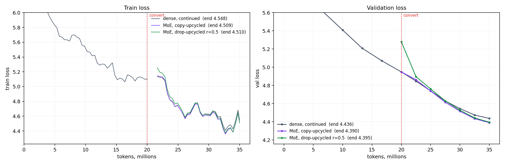
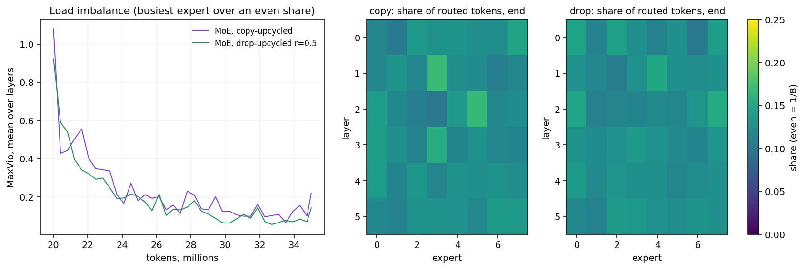

# Session 14 — Mixture of Experts

The assignment is Section 21 of the lesson: *"Train a Linear model and convert that into an MoE! Your
call on model size and data trained on, but must show they continue to train and reduce loss!"*

"Linear model" is read here as the lesson's standard (dense) model, the thing Section 15's upcycling
converts. A dense GPT is trained, turned into an 8-expert mixture-of-experts two ways, and both keep
training next to a copy of the dense model that simply continues.

**Model:** nanoGPT (reused from Session 10), 6 layers, 6 heads, `d_model` 384, context 512, vocab 8,192,
tied embeddings, no dropout, no biases. Dense: **13.96M parameters**. After conversion: 8 experts per
layer, top-2, **63.53M total / 21.06M active**.
**Data:** WikiText-103 with Session 13's 8,192-token BPE, read from `Session13/assignment/data/` (not
copied). The dense phase reads train tokens 0–20M; every branch then reads the same tokens 20M–35M, in
the same order. Validation is 50 × 8 × 512 tokens of the validation split.
**Hardware:** GTX 1650 Ti, 4 GiB, fp32. The MoE did not fit at 16 sequences per forward pass, so every
run uses 2 micro-batches of 8 (16 × 512 = 8,192 tokens per optimizer step).
**Optimizer:** AdamW (0.9, 0.95), weight decay 0.1, clip 1.0, peak lr 6e-4.

```bash
cd assignment
python assignment.py selfcheck      # conversion and routing are exact (CPU, float64)
python assignment.py all            # dense phase, then the three branches -> results.json (~1.5 h here)
python assignment.py branch copy    # one branch: dense | copy | drop (needs data/dense.pt)
python plots.py                     # loss.png, routing.png
```

---

## The runs



| phase | model | tokens | val loss, start | val loss, end | train loss, end | tokens/s | peak memory |
|---|---|---|---|---|---|---|---|
| 1 | dense | 0 → 20M | 9.101 | 4.948 | 5.104 | 15,194 | 1.30 GiB |
| 2 | dense, continued | 20M → 35M | 4.948 | 4.437 | 4.548 | 15,192 | 1.35 GiB |
| 2 | **MoE, copy-upcycled** | 20M → 35M | **4.948** | **4.390** | 4.509 | 9,666 | 2.58 GiB |
| 2 | MoE, drop-upcycled r = 0.5 | 20M → 35M | 5.281 | 4.395 | 4.510 | 9,640 | 2.58 GiB |

Phase 1 holds the learning rate constant after a 2% warmup, so any branch can start from its end. Every
phase 2 branch starts a fresh AdamW, re-warms over 1% of its steps, and then decays the learning rate on
a cosine curve to 10%. The dense branch goes through the same schedule as the MoE branches, so the
schedule cannot explain any gap between them.

- **Both MoE models keep training and reducing loss.** Validation loss fell 0.56 (copy) and 0.89 (drop)
  over the 15M tokens after conversion.
- **Copy-upcycling does not change the model at conversion.** Validation loss is 4.9483 before and
  4.9483 after. All 8 experts are the same MLP and the two kept weights sum to 1, so the MoE computes
  exactly what the dense model computes, whatever the router picks. `selfcheck` asserts an exact 0.0
  difference in float64.
- **Drop-upcycling starts 0.33 worse.** Redrawing half of each expert's neurons costs that much at
  conversion. It is back level with the dense branch by 27.5M tokens (4.630 against 4.629) and ends 0.005
  behind copy.
- **Both MoE models end ahead of the continued dense model:** copy by 0.047 and drop by 0.041. Copy
  starts behind it (+0.015 at 22.5M). The two are level at 25M, and the gap widens every evaluation after
  that.

**What the gain cost.** It is a win per token, not per unit of compute. Each MoE token uses 21.1M active
parameters against 14.0M, and the MoE ran 1.57× slower here (9.7k against 15.2k tok/s). The MoE branch
took 1,552 s of training. In the same time the dense model would have read about 23.6M tokens, not 15M.
That is more than this run gave it, so this run does not show the MoE winning at equal compute. It also
holds 4.5× the parameters, and 2.58 GiB against 1.35 GiB of memory. This is the trade Section 6 of the
lesson describes. A fair compute-matched comparison would need a longer dense branch. Section 15 also
says upcycling stops paying beyond about 1.2–2× the dense budget. This branch is 0.75× of it.

## Routing



The router is new (normal, std 0.02). Balancing uses only the auxiliary-loss-free bias from Section 13:
after each step, `b_j += 0.001 · sign(mean load − load_j)`. The bias is added to the router scores only
when choosing experts, never to the mixing weights. No auxiliary loss is used.

| | MaxVio, first 50 steps | lowest | last 50 steps | dead experts (any 50-step window) | share per expert at the end (even = 0.125) |
|---|---|---|---|---|---|
| copy | 1.08 | 0.06 | 0.22 | 0 | 0.099 – 0.170 |
| drop | 0.92 | 0.05 | 0.14 | 0 | 0.100 – 0.153 |

MaxVio is the busiest expert's load above an even share, averaged over the 6 layers.

- **No expert died, and no clone family collapsed.** Section 15 warns that copies with no redrawn
  neurons give the router nothing to tell apart. In copy-upcycling the router gets *zero* gradient at
  first, because the experts are identical and the output does not depend on which two are chosen. The
  bias spread the tokens evenly anyway, so each copy received a different stream of tokens, and that
  made the copies drift apart. The Lightning LM collapse happened with 23 clones per family and 460
  experts. Here there are 8 clones of one MLP, so it was not tested at that scale.
- **Drop-upcycling balances slightly better throughout** (0.14 against 0.22 at the end). Its experts
  differ from step 0, so the router has something to learn from immediately.
- **Copy reached the lower loss in this run**, which matches the Amazon result in Section 15:
  drop-upcycling was slightly worse than plain copying at small scale. The 0.005 gap is from one seed and
  may be noise.

## What `selfcheck` proves

1. Copy-upcycling with (E, k) = (8, 2), (4, 1) and (1, 1), and the bias set to random values, gives the
   same loss as the dense model. The difference is exactly 0.
2. Dropless dispatch, which gathers each expert's tokens and scatter-adds the weighted outputs back,
   matches a reference that computes every expert for every token and mixes the top-k. The largest
   error is 3.5e-18.
3. With r = 0.5, drop-upcycling redraws exactly half of the hidden neurons (the rows of `c_fc` and the
   columns of `c_proj`) and leaves the other half bit-exact.

## Not done

- An MoE trained from scratch, which would show where upcycling stops paying.
- A dense branch run to equal compute (about 23.6M tokens) instead of equal tokens.
- Partition upcycling, as in Qwen1.5-MoE, and a shared expert.
